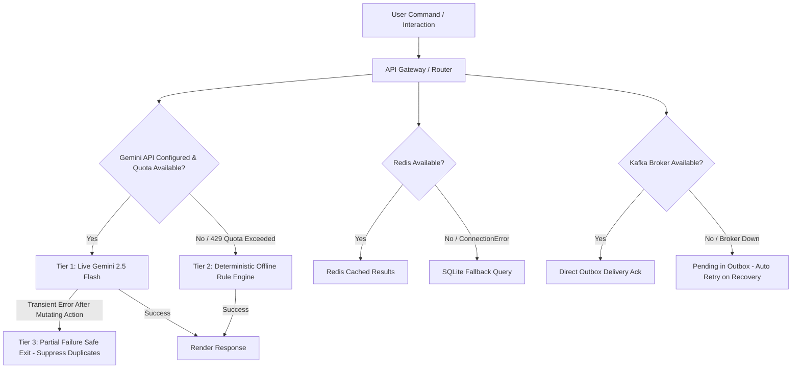

# STAGE — Architectural Specification & Engineering Deep Dive

**Platform Version:** Milestone 7.3+ (Role-Based Environments & Security Hardening)  
**Authoritative Location:** `~/Documents/STAGE/ARCHITECTURE.md`  
**Date:** November 2026

---

## 1. System Topology & Architectural Overview

STAGE is engineered as a decoupled, multi-tiered live cultural platform. The system coordinates client interactions, relational persistence, distributed caching, local vector search, autonomous multi-agent reasoning, and transactional event streaming:

```mermaid
graph TD
    subgraph Client Tier
        Browser[Modern Web Browser]
        NextApp[Next.js 16 / React 19 Frontend App]
        Browser <--> NextApp
    end

    subgraph API & Gateway Tier
        FastAPI[FastAPI Asynchronous Gateway - Port 8000]
        NextApp <-->|REST / JSON + Bearer Auth| FastAPI
        AuthGuard[Role & Identity Guard: require_role]
        FastAPI --> AuthGuard
    end

    subgraph Primary Relational & Event Storage
        DB[(SQLite: stage.db)]
        AuthGuard --> DB
        OutboxTable[(Table: event_outbox)]
        DB -.->|Atomic Transaction| OutboxTable
    end

    subgraph Discovery & Low-Latency Cache
        Redis[(Redis 8: 127.0.0.1:6379)]
        FastAPI <-->|g{generation}:v{version}:{hash}| Redis
        MCPServer[Local Stdio MCP Venue Server]
        FastAPI <-->|JSON-RPC Stdio| MCPServer
        MCPServer <--> DB
    end

    subgraph Event Streaming & Idempotent Processing
        OutboxPub[Transactional Outbox Publisher]
        OutboxTable -->|Poll & Relay| OutboxPub
        Kafka[(Kafka Broker: stage.events 9092)]
        OutboxPub -->|At-Least-Once Delivery| Kafka
        ConsumerNotif[Consumer: stage-notifications]
        ConsumerAnal[Consumer: stage-analytics]
        Kafka --> ConsumerNotif
        Kafka --> ConsumerAnal
        ConsumerNotif -->|Deduplicated Write| DB
        ConsumerAnal -->|Deduplicated Write| DB
    end

    subgraph Agentic Intelligence & Vector RAG
        ADKRunner[Google ADK Runner]
        FastAPI <--> ADKRunner
        Orch[STAGE Orchestrator Agent]
        ADKRunner --> Orch
        SM[StageMatch Agent]
        CA[CivicAssist Agent]
        IF[ImpactFlow Agent]
        Orch -->|Dynamic Handoff| SM
        Orch -->|Dynamic Handoff| CA
        Orch -->|Dynamic Handoff| IF
        SM -->|Tool Call| MCPServer
        CA <-->|Dense Cosine Search| Chroma[(ChromaDB: Civic Acoustic RAG)]
        Embed[all-MiniLM-L6-v2 Embeddings]
        Chroma <--> Embed
    end
```

---

## 2. Frontend / Backend Request Flow

### 2.1 Communication Protocol & Transport
- **Client Application**: Next.js 16 App Router using React 19 with client-side reactive context (`StageStoreContext.tsx`) and modular workspace views.
- **Transport**: Standard HTTP/1.1 REST over JSON targeting base URL `http://127.0.0.1:8000`.
- **API Client Layer (`frontend/src/services/api.ts`)**:
  - Implements a unified `request<T>(endpoint, options)` wrapper.
  - Automatically extracts `stage_auth_token` from browser `localStorage` and injects `Authorization: Bearer <token>` on all outgoing calls.
  - Catches non-2xx responses, deserializes standardized error payloads (`{ detail: string }`), and throws strongly typed `ApiError` instances with HTTP status codes.

```sequenceDiagram
participant Client as Next.js Client
participant Gateway as FastAPI Router
participant Auth as Auth Middleware (require_role)
participant DB as SQLite Transaction
participant Outbox as Transactional Outbox
participant Redis as Redis Cache

Client->>Gateway: POST /api/requests (Pitch Submission)
Gateway->>Auth: Verify Bearer Token & Role ('performer')
Auth-->>Gateway: Authenticated Performer (usr-aarav)
Gateway->>DB: Check Impersonation & Duplicate Pitches
Gateway->>DB: INSERT INTO performance_requests
Gateway->>Outbox: INSERT INTO event_outbox (request.status_changed)
DB-->>Gateway: Commit Transaction (Atomicity Guaranteed)
Gateway-->>Client: HTTP 201 Created (PerformanceRequestResponse)
```

---

## 3. Authentication & Role Authorization

### 3.1 Cryptographic Password Security
- **Algorithm**: **bcrypt** (work factor 12, `rounds=12`) via the native Python `bcrypt` library.
- **Salt Generation**: 128-bit cryptographically secure per-user random salt generated automatically on every password hash operation.
- **Comparison**:
  - Bcrypt hashes: Verified using `bcrypt.checkpw()`.
  - Legacy hashes: Fallback verification uses SHA-256 with constant-time equality check via `secrets.compare_digest()`.
  - Fails closed: Empty, null, or invalid password hashes strictly return `False`.

### 3.2 Session Management & Lifecycle
- **Token Generation**: High-entropy tokens generated using `secrets.token_urlsafe(32)` prefixed with `stg_tok_` (51 characters, 256 bits of entropy).
- **Session Persistence**: Sessions are recorded in the `user_sessions` SQLite table:
  ```sql
  CREATE TABLE user_sessions (
      token TEXT PRIMARY KEY,
      user_id TEXT NOT NULL REFERENCES users(id) ON DELETE CASCADE,
      role TEXT NOT NULL,
      created_at TIMESTAMP DEFAULT CURRENT_TIMESTAMP,
      expires_at TIMESTAMP NOT NULL
  );
  ```
- **Session Verification**: `get_user_by_token(token)` joins `user_sessions` with `users` and strictly enforces `expires_at > CURRENT_TIMESTAMP`.
- **Revocation**: `POST /api/auth/logout` explicitly deletes the token row from SQLite. Subsequent requests return `HTTP 401`.

### 3.3 Authorization Decorator: `require_role(allowed_roles)`
Every protected endpoint in FastAPI depends on the dependency `require_role(allowed_roles)`:
1. **Bearer Token Check**: Deserializes `Authorization: Bearer <token>`. Rejects missing/expired tokens with `HTTP 401 Unauthorized`.
2. **Role Check**: Verifies `user["role"] in allowed_roles or user["role"] == "admin"`. Rejects unauthorized roles with `HTTP 403 Forbidden`.
3. **Explicit Header Check (`X-STAGE-Role`)**: Permitted for automated integration tests and local development. If `X-STAGE-Role: admin` is presented, the server strictly validates `X-STAGE-Admin-Secret: stage_admin_key_2026`. Missing or invalid admin secrets return `HTTP 403 Forbidden`.
4. **Fail-Closed Fallback**: Requests lacking credentials receive `HTTP 401 Unauthorized`.

### 3.4 Impersonation Prevention & Pitch Ownership
- **Performer Identity Binding**: On `POST /api/requests`, the backend queries `performer_profiles` associated with `current_user["id"]`. If the request body specifies another performer's ID, the server rejects it with `HTTP 403 Forbidden`.
- **Ownership Check**: On `PUT /api/requests/{id}`, `POST /withdraw`, and `POST /resubmit`, `_check_pitch_ownership()` validates that `req["performer_id"]` belongs to the authenticated user. Non-owners receive `HTTP 403 Forbidden`.
- **Host Authority Check**: On `PATCH /api/requests/{id}/status`, `_check_venue_host_authority()` verifies that the caller owns the host venue or holds platform admin rights.
- **Material Term Protection**: Modifying key parameters (`date`, `venue_id`, `budget`, or `title`) on an approved pitch automatically reverts status to `pending`, adds an audit record to `status_history`, and logs a notification for the venue host.

---

## 4. Google ADK Multi-Agent Orchestrator & Specialist Architecture

STAGE implements a multi-agent orchestration architecture using the **Google Agent Development Kit (`google-adk`)**:

```
                       ┌─────────────────────────┐
                       │   stage_orchestrator    │
                       │   (Root ADK Runner)     │
                       └────────────┬────────────┘
                                    │
            ┌───────────────────────┼───────────────────────┐
            │                       │                       │
 ┌──────────▼──────────┐ ┌──────────▼──────────┐ ┌──────────▼──────────┐
 │  stage_match_agent  │ │ civic_assist_agent  │ │  impact_flow_agent  │
 │  (Venue Discovery)  │ │ (Acoustic Compliance│ │ (Cause Pledges)     │
 └──────────┬──────────┘ └──────────┬──────────┘ └──────────┬──────────┘
            │                       │                       │
      ┌─────▼─────┐           ┌─────▼─────┐           ┌─────▼─────┐
      │ MCP Tools │           │  ChromaDB │           │  SQLite   │
      │ (Stdio)   │           │ Vector RAG│           │  Ledger   │
      └───────────┘           └───────────┘           └───────────┘
```

### 4.1 Orchestrator Pattern
- **Root Agent**: `stage_orchestrator` acts as the primary intent classifier and routing coordinator.
- **Specialist Delegation**: Configured with `sub_agents=[stage_match_agent, civic_assist_agent, impact_flow_agent]`.
- **Agent Handoffs**: Transfers control dynamically based on user utterances. Context is maintained across transfers via `session_id`.

### 4.2 Specialist Responsibilities
1. **StageMatch (`stage_match_agent`)**:
   - Analyzes acoustic genre requirements, seating configurations, and artist budget constraints.
   - Invokes MCP tools (`search_stages`, `compute_match_score`).
2. **CivicAssist (`civic_assist_agent`)**:
   - Analyzes municipal zoning laws, night curfews, and sound thresholds.
   - Invokes ChromaDB vector retrieval tools (`retrieve_civic_guidance`, `query_civic_knowledge`).
3. **ImpactFlow (`impact_flow_agent`)**:
   - Evaluates performance cause alignment and models percentage-based crowd-pledge allocations.
   - Invokes campaign tools (`recommend_causes`, `simulate_crowdfund_impact`, `record_ticket_pledge`).

### 4.3 Side-Effect Tracking & Safety
- Mutating tools (`create_booking`, `record_ticket_pledge`) are tracked during runner execution.
- If a transient network failure occurs after a mutating tool has completed, the orchestrator suppresses fallback retries to prevent duplicate database writes.

---

## 5. Model Context Protocol (MCP) Venue Integration

The Model Context Protocol establishes an isolated tool integration boundary between agent reasoning and database access:

- **Server Architecture**: Runs as a separate Python stdio subprocess (`backend/app/mcp_server/venue_server.py`) using the official `mcp` SDK.
- **Exposed Tools**:
  - `search_stages(city, max_capacity, stage_type)`: Performs filtered venue queries against SQLite.
  - `compute_match_score(venue_id, requirements)`: Computes deterministic fit scores based on equipment and capacity ratios.
- **ADK Integration**: `StageAgentService` connects to the MCP child process via Google ADK's `McpToolset`. Tool schemas are discovered dynamically at startup over stdio JSON-RPC.

---

## 6. Local Semantic RAG (ChromaDB + SentenceTransformers)

CivicAssist provides grounded acoustic compliance verification via local vector retrieval:

- **Persistence**: ChromaDB `PersistentClient` targeting `backend/data/chroma_db/chroma.sqlite3`.
- **Embeddings**: `sentence-transformers/all-MiniLM-L6-v2` running on CPU, producing 384-dimensional normalized vector embeddings.
- **Document Indexing**: Curated municipal acoustic guidelines across Indian cultural centers:
  - `DOC-CIVIC-001`: Chennai Coastal & Heritage Zone Acoustic Guidelines.
  - `DOC-CIVIC-002`: Kolkata Riverfront Heritage Precinct Regulations.
  - `DOC-CIVIC-003`: Public Parks Open-Air Sound Management.
  - `DOC-CIVIC-004`: Private Acoustic Performance Venues Standard Operating Procedures.
- **Retrieval Pipeline**: Combines dense vector cosine similarity (filtering chunks with score $< 0.35$) with exact metadata pre-filtering on `city`, `zone`, and `category`. Every response cites document IDs and sections.

---

## 7. High-Performance Redis Caching with Durable Generations

To ensure instant discovery responses while eliminating stale reads, venue searches utilize a hardened Redis cache:

### 7.1 Cache Key Formulation
```
stage:venues:g{durable_generation}:v{redis_version}:{canonical_sha256_hash}
```
- **Durable Generation ($g$)**: Stored in SQLite table `durable_cache_generations`. Incremented atomically inside the venue creation transaction.
- **Redis Version ($v$)**: Incremented in Redis upon cache invalidation.
- **Canonical Hash**: SHA-256 hash computed over sorted, canonicalized search parameters.

### 7.2 Stale Write Elimination Algorithm
```
1. Search begins -> Read current SQLite durable generation G1.
2. Query Redis cache for key matching G1.
   a. On Cache Hit -> Re-read generation G2 from SQLite.
      - If G1 == G2: Return cached venues immediately.
      - If G1 != G2: Cache invalidated concurrently! Discard hit, query SQLite.
   b. On Cache Miss -> Query SQLite database for matching venues.
      - Before writing to Redis: Verify generation G3 == G1.
      - If verified: Write to Redis with TTL=300s.
      - If generation changed: Abort write (prevents stale write race).
```

### 7.3 Fail-Closed Concurrency & Outage Recovery
- If SQLite generation checks fail or Redis is unreachable, the system fails closed: writes are suppressed, and queries fall back directly to SQLite.

---

## 8. Transactional Event Outbox & Apache Kafka Bus

STAGE employs the **Transactional Outbox Pattern** to ensure reliable, at-least-once event delivery between SQLite mutations and Apache Kafka:

```
┌────────────────────────────────────────────────────────┐
│               FastAPI API Handler                      │
│                                                        │
│  BEGIN TRANSACTION;                                    │
│    INSERT INTO stage_venues / bookings / requests ...  │
│    INSERT INTO event_outbox (aggregate_id, payload) ...│
│  COMMIT;                                               │
└───────────────────────────┬────────────────────────────┘
                            │
               ┌────────────▼─────────────┐
               │  SQLite Database Engine  │
               │   (Atomic Consistency)   │
               └────────────┬─────────────┘
                            │
               ┌────────────▼─────────────┐
               │ Outbox Publisher Thread │
               │ (Polls every 500ms)      │
               └────────────┬─────────────┘
                            │
               ┌────────────▼─────────────┐
               │ Apache Kafka 4.4 Broker  │
               │ Topic: 'stage.events'    │
               │ (Partitions: 3)          │
               └────────────┬─────────────┘
                            │
            ┌───────────────┴───────────────┐
            │                               │
┌───────────▼───────────┐       ┌───────────▼───────────┐
│ Consumer Group:       │       │ Consumer Group:       │
│ 'stage-notifications' │       │ 'stage-analytics'     │
│ (In-App Alerts)       │       │ (Metrics Ledger)      │
└───────────────────────┘       └───────────────────────┘
```

### 8.1 Event Types & Aggregates
- `venue.created`: Aggregated by venue ID.
- `booking.created`: Aggregated by booking ID.
- `contribution.recorded`: Aggregated by contribution ledger ID.
- `request.status_changed`: Aggregated by performance request ID.
- `campaign.created`: Aggregated by social cause ID.

### 8.2 Outbox Table Schema
```sql
CREATE TABLE event_outbox (
    id TEXT PRIMARY KEY,
    event_type TEXT NOT NULL,
    aggregate_type TEXT NOT NULL,
    aggregate_id TEXT NOT NULL,
    payload TEXT NOT NULL,
    created_at TIMESTAMP DEFAULT CURRENT_TIMESTAMP,
    published_at TIMESTAMP NULL,
    attempts INTEGER DEFAULT 0,
    last_error TEXT NULL
);
```

### 8.3 Kafka Broker Configuration
- **Broker**: `127.0.0.1:9092` (KRaft mode).
- **Topic**: `stage.events` (3 partitions, replication factor 1).
- **Partitioning Key**: `aggregate_id` (ensures strict per-aggregate ordering).

### 8.4 Idempotent Consumer Deduplication
Consumers maintain deduplication state in `processed_events`:
```sql
CREATE TABLE processed_events (
    event_id TEXT NOT NULL,
    consumer_group TEXT NOT NULL,
    processed_at TIMESTAMP DEFAULT CURRENT_TIMESTAMP,
    PRIMARY KEY (event_id, consumer_group)
);
```
Before executing side-effects, consumers check if `(event_id, consumer_group)` exists. Replayed events are discarded safely without duplicate notifications or double-counted analytics rows.

---

## 9. Error Handling, Resilience & Offline Fallback

STAGE implements a layered resilience model ensuring high availability regardless of external infrastructure status:



1. **Gemini Quota Exceeded (HTTP 429)**: The system catches `RESOURCE_EXHAUSTED` errors from Gemini and transparently activates the deterministic offline rule engine.
2. **Redis Outage**: When Redis is down, searches fall back to direct SQLite execution; venue creation continues uninterrupted by writing durable generations to SQLite.
3. **Kafka Broker Outage**: When Kafka is unreachable, business mutations commit safely to SQLite. Events remain queued in `event_outbox` with incrementing attempt counters and publish automatically when the broker recovers.

