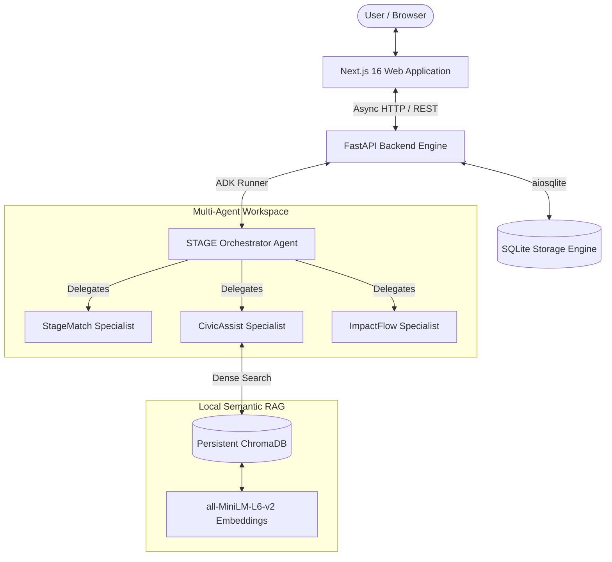

# STAGE — Autonomous Agentic AI Platform

STAGE is an agentic AI platform that connects performance artists, venue hosts, civic authorities, and community causes. Powered by the Google Agent Development Kit (ADK) and Gemini models, STAGE orchestrates specialized autonomous agents to streamline venue discovery, automate municipal sound and curfew compliance via semantic RAG, and channel live performance proceeds toward verified community initiatives.

---

## Table of Contents

- [Platform Overview](#platform-overview)
- [Key Features](#key-features)
- [System Architecture](#system-architecture)
- [Multi-Agent System](#multi-agent-system)
- [Semantic RAG Engine](#semantic-rag-engine)
- [Technology Stack](#technology-stack)
- [Database Schema & REST API](#database-schema--rest-api)
- [AI Command Centre & Execution Safety](#ai-command-centre--execution-safety)
- [Installation & Local Setup](#installation--local-setup)
- [Verification & Test Suites](#verification--test-suites)
- [Milestone Checkpoint & Safety Implementation](#milestone-checkpoint--safety-implementation)
- [Roadmap & Limitations](#roadmap--limitations)
- [License](#license)

---

## Platform Overview

STAGE coordinates four primary stakeholders across live urban cultural ecosystems:

1. **Performers**: Indie musicians, theatre ensembles, and acoustic artists seeking suitable performance spaces, transparent scheduling, and automated compliance checking.
2. **Venue Hosts**: Independent cafes, open-air amphitheatres, cultural halls, and studio spaces looking to maximize utilization while respecting zoning and decibel regulations.
3. **Audiences**: Urban event-goers seeking hyper-local performances with transparent cause-based ticket contributions.
4. **Social Causes**: Verified non-profits and civic initiatives that receive crowd-funded micro-pledges generated during live performances.

---

## Key Features

- **Multi-Agent Orchestration**: Native Google ADK workflow featuring a top-level orchestrator that coordinates domain-specific specialist agents.
- **Semantic RAG with ChromaDB**: Local vector retrieval over civic and municipal acoustic guidelines using `sentence-transformers/all-MiniLM-L6-v2` with dense cosine similarity and metadata filtering.
- **Resilient AI Execution & Safety**: 3-tier execution model (Live Gemini, Deterministic Offline, and Partial Failure Safe Exit) with mutating tool tracking to prevent duplicate database writes on network failures.
- **Observable AI Command Centre**: Real-time visualization of agent transitions, tool invocations, function arguments, and streaming responses.
- **Dual Execution Engine**: Full platform functionality operates offline deterministically when an API key is not present, ensuring zero vendor lock-in and uninterrupted development.

---

## System Architecture



---

## Multi-Agent System

STAGE implements a hierarchical multi-agent architecture built on the Google Agent Development Kit (`google-adk`):

### 1. STAGE Orchestrator (`stage_orchestrator`)
- Acts as the primary user-facing conversational coordinator.
- Inspects incoming requests, determines agent routing requirements, and delegates tasks to domain specialists using native ADK sub-agent handoffs.
- Synthesizes findings from multiple specialists into coherent, structured responses.

### 2. StageMatch Specialist (`stage_match_agent`)
- Dedicated to venue discovery, acoustic fitment evaluation, and booking generation.
- **Tools**:
  - `search_stages(city, max_capacity, stage_type)`: Queries the SQLite database for candidate venues filtered by capacity and acoustic suitability.
  - `compute_match_score(venue_id, requirements)`: Scores venue compatibility based on technical equipment, capacity ratios, and acoustic constraints.
  - `create_booking(venue_id, artist_id, requested_date, agreed_rate)`: Creates confirmed venue booking records in the database.

### 3. CivicAssist Specialist (`civic_assist_agent`)
- Dedicated to regulatory analysis, municipal curfew checking, noise level compliance, and permit guidance.
- **Tools**:
  - `check_curfew_rules(city, zone, sound_type)`: Quick rule-based verification of municipal curfew and baseline sound limits.
  - `retrieve_civic_guidance(query, city, category)`: Semantic retrieval interface querying the local ChromaDB vector database.
  - `query_civic_knowledge(query, city, zone, category)`: Detailed hybrid semantic query tool returning section-level citations, noise thresholds, and compliance recommendations.

### 4. ImpactFlow Specialist (`impact_flow_agent`)
- Dedicated to non-profit discovery, social cause alignment, and ticket pledge calculations.
- **Tools**:
  - `recommend_causes(category, city)`: Retrieves verified social causes matching performance genres and locations.
  - `simulate_crowdfund_impact(ticket_price, target_attendance, pledge_percentage)`: Calculates projected micro-contributions and social impact metrics.
  - `record_ticket_pledge(event_id, cause_id, pledge_amount)`: Records an immutable cause pledge for a scheduled performance.

---

## Semantic RAG Engine

CivicAssist employs a fully local semantic retrieval pipeline powered by ChromaDB and SentenceTransformers:

- **Vector Database**: ChromaDB (`chromadb==1.5.9`) operating via `PersistentClient` targeting `backend/data/chroma_db`.
- **Embedding Model**: `sentence-transformers/all-MiniLM-L6-v2` generating 384-dimensional normalized vector embeddings running purely on local CPU.
- **Chunking Strategy**: Section-aware semantic chunking preserving document hierarchy, municipal authority metadata, applicable city zones, curfew hours, and maximum decibel allowances.
- **Similarity Metric**: Cosine similarity normalized to $[0.0, 1.0]$. A relevance threshold of $0.35$ filters low-confidence context chunks.
- **Metadata Filtering**: Exact-match pre-filtering on municipal fields (`city`, `zone`, `category`).
- **Citation Attribution**: Every retrieved answer includes explicit document identifiers (`doc_id`), section references, and confidence scores.
- **Corpus**:
  - `DOC-CIVIC-001`: Chennai Coastal & Heritage Zone Acoustic Guidelines
  - `DOC-CIVIC-002`: Kolkata Riverfront Heritage Precinct Regulations
  - `DOC-CIVIC-003`: Public Parks Open-Air Sound Management
  - `DOC-CIVIC-004`: Private Acoustic Performance Venues Standard Operating Procedures

> **Civic Disclaimer**: All civic guidelines, municipal curfews, and regulatory data provided in the platform are demonstration records curated for prototype evaluation. They do not constitute statutory legal advice or official government directives.

---

## Technology Stack

| Component | Technology | Version | Purpose |
| :--- | :--- | :--- | :--- |
| **Frontend Framework** | Next.js | `16.4.6` | App router, server and client components |
| **UI Library** | React | `19.3.0` | Declarative user interfaces |
| **Styling** | Tailwind CSS | `4.3.3` | Utility-first responsive styling |
| **Backend Framework** | FastAPI | `0.165.0` | High-performance asynchronous API server |
| **ASGI Server** | Uvicorn | `0.54.0` | Asynchronous server implementation |
| **Agent Framework** | Google ADK | `2.15.0` | Autonomous multi-agent coordination |
| **Model SDK** | Google GenAI | `2.34.0` | Gemini 2.5 Flash / Pro model connectivity |
| **Vector Database** | ChromaDB | `1.5.9` | Local persistent vector storage |
| **Embedding Engine** | SentenceTransformers | `6.3.0` | Local dense embedding inference |
| **Deep Learning Runtime** | PyTorch | `2.15.0` | CPU tensor compute for embeddings |
| **Database** | SQLite + aiosqlite | `0.22.1` | Asynchronous relational data persistence |
| **Data Validation** | Pydantic | `2.14.4` | Request and response schema enforcement |

---

## Database Schema & REST API

The SQLite persistence layer contains 8 normalized relational tables:

1. `users`: Artist, host, and organizer accounts.
2. `stage_venues`: Venue profiles, location coordinates, sound limits, and capacity ratings.
3. `performance_requests`: Incoming booking requests submitted by performers.
4. `stage_events`: Scheduled performances, time slots, and ticketing status.
5. `bookings`: Confirmed venue reservations and contractual arrangements.
6. `causes`: Registered civic initiatives and non-profit partner profiles.
7. `contributions`: Ticket pledge allocations and community funding records.
8. `notifications`: In-app event alerts, compliance warnings, and booking confirmations.

### Primary API Endpoints

| Method | Endpoint | Description |
| :--- | :--- | :--- |
| `POST` | `/api/ai/command` | Main entry point for the Multi-Agent Orchestrator |
| `GET` | `/api/venues` | List and search venues with acoustic filtering |
| `POST` | `/api/venues` | Register a new performance venue |
| `GET` | `/api/requests` | List artist performance and booking requests |
| `POST` | `/api/requests` | Submit a new performance inquiry |
| `GET` | `/api/events` | Retrieve scheduled performances and line-ups |
| `POST` | `/api/events` | Schedule and publish a new performance event |
| `GET` | `/api/bookings` | List active and historical venue bookings |
| `POST` | `/api/bookings` | Confirm venue reservation |
| `GET` | `/api/causes` | List verified community and social causes |
| `POST` | `/api/contributions` | Record a ticket pledge contribution |
| `GET` | `/api/notifications` | Fetch user alerts and compliance notices |
| `GET` | `/health` | Backend service health and status probe |

---

## AI Command Centre & Execution Safety

The frontend includes an interactive **AI Command Centre** (`/dashboard/command`) that provides glass-box observability into the multi-agent system:

- **Execution Modes**:
  - `live_gemini`: Live execution with Gemini via Google ADK.
  - `offline_deterministic`: High-speed rule-based execution for local development without API credentials.
  - `live_gemini_partial_failure`: Graceful error recovery when a transient fault occurs after side-effect operations have completed.
- **Mutating Side-Effect Protection**: Mutating tools (`create_booking`, `record_ticket_pledge`) are tracked during execution. If a failure occurs after a mutating action has executed, the system suppresses fallback retries to prevent duplicate database writes.
- **Isolated Attempt Sessions**: Multi-agent retries operate inside isolated child sessions, ensuring failed attempt artifacts do not pollute the primary conversation history.
- **Transient Retries**: Up to 3 attempts with exponential backoff and jitter for transient 5xx HTTP errors, while routing non-retryable 4xx authentication errors cleanly.

---

## Installation & Local Setup

### Prerequisites

- macOS or Linux operating system
- Python 3.12+
- Node.js 20+ and npm 10+
- (Optional) Google Gemini API Key

### 1. Clone the Repository

```bash
git clone https://github.com/arunshrinivaas/stage-agentic-platform.git
cd stage-agentic-platform
```

### 2. Backend Setup

```bash
cd backend

# Create and activate Python virtual environment
python3 -m venv .venv
source .venv/bin/activate

# Install dependencies
pip install -r requirements.txt

# Configure environment
cp .env.example .env
# Edit .env to add your GEMINI_API_KEY (optional; system runs offline without it)

# Launch backend server
uvicorn app.main:app --host 127.0.0.1 --port 8000 --reload
```

The backend API will be available at `http://127.0.0.1:8000` with interactive OpenAPI documentation at `http://127.0.0.1:8000/docs`.

### 3. Frontend Setup

In a separate terminal window:

```bash
cd frontend

# Install npm dependencies
npm install

# Configure environment
cp .env.example .env.local

# Launch Next.js development server
npm run dev
```

The frontend dashboard will be available at `http://localhost:3000`.

---

## Verification & Test Suites

The backend includes 5 automated test suites covering API contracts, multi-agent coordination, semantic vector retrieval, and live execution resilience:

```bash
cd backend
source .venv/bin/activate

# 1. API Endpoints and Database Operations
pytest test_api.py -v

# 2. ADK Multi-Agent Orchestration & Tool Calls
pytest test_adk_agents.py -v

# 3. CivicAssist RAG Retrieval & Source Attribution
pytest test_milestone5_rag.py -v

# 4. ChromaDB Semantic Search & Vector Embeddings
pytest test_milestone5_semantic_rag.py -v

# 5. Gemini Resilience, Retry Policies & Partial Failure Safety
pytest test_resilient_gemini.py -v
```

All 53 unit, integration, and architecture tests pass deterministically.

---

## Milestone Checkpoint & Safety Implementation

This repository reflects the completed **Milestone 6.1.2** implementation:

- Full migration from lexical search to persistent ChromaDB semantic vector search.
- Separation of agent routing observations from state-modifying tool invocations.
- Protection against duplicate side-effect execution during model failover.
- Verified live Gemini 2.5 Flash execution alongside deterministic offline parity.

---

## Roadmap & Limitations

- **Zoning Accuracy**: Municipal sound rules are demonstration representations. Integration with real-time municipal APIs is planned for future milestones.
- **Payment Gateway**: Ticket pledges are simulated in database records. Direct UPI/payment gateway integration is slated for Milestone 7.
- **Acoustic Simulation**: Match scoring utilizes heuristic rules. Digital twin acoustic ray-tracing will be explored in future releases.

---

## License

This project is licensed under the MIT License — see the [LICENSE](LICENSE) file for details.
