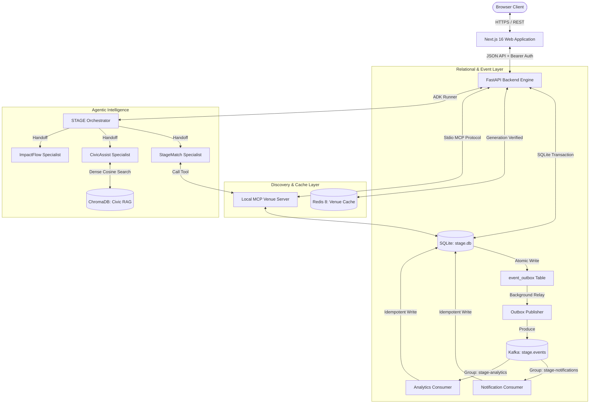

# STAGE — Autonomous Agentic Cultural Platform

**Where talent meets purpose.**

STAGE is an agentic AI platform that unites performance artists, stage providers, audiences, and grassroots civic causes into a transparent, purpose-driven live cultural ecosystem. Powered by the **Google Agent Development Kit (ADK)**, **Gemini models**, **Model Context Protocol (MCP)**, **Redis caching**, **ChromaDB vector RAG**, and **Apache Kafka event streaming**, STAGE coordinates hyper-local venue matching, municipal acoustic compliance checking, and ticket-backed civic impact contributions.

---

## Table of Contents

1. [Platform Overview & Roles](#platform-overview--roles)
2. [Technology Stack](#technology-stack)
3. [System Architecture](#system-architecture)
4. [Autonomous Multi-Agent System (Google ADK)](#autonomous-multi-agent-system-google-adk)
5. [Core Subsystems](#core-subsystems)
   - [Model Context Protocol (MCP) Venue Server](#1-model-context-protocol-mcp-venue-server)
   - [Semantic RAG Engine (ChromaDB)](#2-semantic-rag-engine-chromadb)
   - [High-Performance Venue Cache (Redis)](#3-high-performance-venue-cache-redis)
   - [Transactional Event Outbox & Kafka Bus](#4-transactional-event-outbox--kafka-bus)
6. [Authentication & Role-Based Workspaces](#authentication--role-based-workspaces)
7. [Demo Personas & Access Instructions](#demo-personas--access-instructions)
8. [Local Installation & Startup Commands](#local-installation--startup-commands)
9. [Verification & Test Suites](#verification--test-suites)
10. [Security Boundaries & Limitations](#security-boundaries--limitations)
11. [Simulated Payment & Contribution Disclaimer](#simulated-payment--contribution-disclaimer)
12. [License](#license)

---

## Platform Overview & Roles

STAGE coordinates four primary cultural stakeholders through dedicated authenticated workspaces:

```
                  ┌──────────────────────────────────────────────┐
                  │                 STAGE Web App                │
                  │             (Next.js 16 + React 19)          │
                  └──────┬──────────────┬──────────────┬─────────┘
                         │              │              │
        ┌────────────────▼──┐    ┌──────▼──────┐   ┌───▼────────────────┐
        │  Performer Space  │    │  Host Space │   │   Audience Portal  │
        │   (Aarav Mehta)   │    │  (Priya S.) │   │     (Rhea Sen)     │
        └───────────────────┘    └─────────────┘   └────────────────────┘
                         │              │              │
                         └──────┬───────┴──────────────┘
                                │
                  ┌─────────────▼────────────────┐
                  │    Organiser & Cause Hub     │
                  │   (Delta Melody Foundation)  │
                  └──────────────────────────────┘
```

1. **Performer (`/dashboard/performer`)**:
   - Discover suitable acoustic stages filtered by capacity, neighborhood, and sound policy.
   - Submit formal performance pitches with technical riders, duration, and target dates.
   - Edit pitch details with automatic review status reversion when material terms change.
   - Withdraw or resubmit pitches with complete audit history tracking.

2. **Stage Provider (`/dashboard/provider`)**:
   - Register and curate unique performance spaces (heritage lofts, open-air amphitheatres).
   - Review incoming pitches from artists with complete technical specifications.
   - Approve, return for revisions (with host review notes), or decline pitches.

3. **Audience (`/dashboard/audience`)**:
   - Discover curated live performances across city cultural districts.
   - Book tickets with instant seat allocation and verifiable digital passes (`STG-PASS-*`).
   - Track micro-pledges redirected from ticket proceeds toward community causes.

4. **Organiser (`/dashboard/organiser`)**:
   - Launch and steward verified social impact campaigns.
   - Monitor transparent contribution ledgers funded automatically by linked performances.
   - Track impact metrics (instruments distributed, children tutored, community spaces preserved).

5. **Platform Administrator (`/dashboard/command`)**:
   - Inspect glass-box AI Command Centre execution, agent handoffs, tool parameters, and streaming reasoning.
   - Exercise cross-role platform oversight and multi-persona simulation.

6. **Demo Sandbox (`/dashboard/demo`)**:
   - Quick-switch hub allowing live presenters to toggle between all 5 personas in a single click without signing out.

---

## Technology Stack

| Layer | Technology | Version | Purpose |
| :--- | :--- | :--- | :--- |
| **Frontend Framework** | Next.js (App Router) | `16.4.6` | Server & client React rendering, route handling |
| **UI Library** | React | `19.3.0` | Declarative component architecture |
| **Styling** | Tailwind CSS | `4.3.3` | Custom luxury editorial styling & design system |
| **Icons** | Lucide React | `1.16.0` | Accessible vector iconography |
| **Backend Framework** | FastAPI | `0.165.0` | Asynchronous high-performance REST API |
| **ASGI Server** | Uvicorn | `0.54.0` | Asynchronous production web server |
| **Agent Framework** | Google ADK | `2.15.0` | Hierarchical multi-agent orchestration |
| **LLM Inference** | Google GenAI | `2.34.0` | Gemini 2.5 Flash / Pro reasoning engine |
| **Tool Protocol** | Model Context Protocol | `1.2.0` | Stdio MCP client/server integration |
| **Vector Database** | ChromaDB | `1.5.9` | Local persistent dense vector storage |
| **Embedding Engine** | SentenceTransformers | `6.3.0` | CPU vector embeddings (`all-MiniLM-L6-v2`) |
| **Cache Store** | Redis | `8.12.0` | Low-latency query caching with durable generations |
| **Event Bus** | Apache Kafka (KRaft) | `4.4.0` | Distributed transactional event streaming |
| **Kafka Client** | confluent-kafka | `2.8.2` | High-throughput C/Python Kafka driver |
| **Primary Database** | SQLite (`sqlite3`) | Standard | Authoritative transactional relational storage |
| **Password Hashing** | bcrypt | `5.0.0` | Cryptographic password hashing (work factor 12) |
| **Schema Validation** | Pydantic v2 | `2.14.4` | Strict request/response validation |

---

## System Architecture



---

## Autonomous Multi-Agent System (Google ADK)

STAGE implements a hierarchical multi-agent architecture built on the **Google Agent Development Kit (`google-adk`)**:

### 1. STAGE Orchestrator (`stage_orchestrator`)
- Acts as the primary conversational coordinator and user-facing intelligence.
- Evaluates user intent, dynamically transfers execution to specialists, and synthesizes answers across domains.

### 2. StageMatch Specialist (`stage_match_agent`)
- Evaluates acoustic fitment, seating capacities, and equipment requirements.
- Uses **Model Context Protocol (MCP)** tools (`search_stages`, `compute_match_score`) to query venues deterministically.

### 3. CivicAssist Specialist (`civic_assist_agent`)
- Specializes in municipal sound laws, outdoor decibel limits, curfew times, and permit guidelines.
- Leverages **ChromaDB Semantic RAG** to retrieve and cite municipal acoustic guidelines across Indian cities.

### 4. ImpactFlow Specialist (`impact_flow_agent`)
- Aligns performance genres with verified grassroots community non-profits.
- Simulates ticket-pledge allocations and audits transparent contribution ledgers.

---

## Core Subsystems

### 1. Model Context Protocol (MCP) Venue Server
- Runs as an isolated stdio child process (`backend/app/mcp_server/venue_server.py`).
- Exposes two strongly typed tools: `search_stages` and `compute_match_score`.
- StageMatch accesses these tools via Google ADK's `McpToolset`, ensuring clean protocol separation between agent reasoning and database access.

### 2. Semantic RAG Engine (ChromaDB)
- Persistent vector collection stored in `backend/data/chroma_db`.
- Local `sentence-transformers/all-MiniLM-L6-v2` dense embedding model running purely on CPU.
- Indexes municipal guidelines (`DOC-CIVIC-001` through `DOC-CIVIC-004`) covering coastal, riverfront, and heritage zones in Kolkata, Mumbai, and Chennai.
- Retrieval combines dense cosine similarity (threshold $\ge 0.35$) with exact metadata pre-filtering on `city`, `zone`, and `category`.

### 3. High-Performance Venue Cache (Redis)
- Distributed caching layer targeting `redis://127.0.0.1:6379/0`.
- **Durable Generations**: Cache keys incorporate a durable generation counter stored in SQLite (`stage:venues:g{generation}:v{version}:{hash}`).
- **Stale Write Elimination**: When a venue is created, the durable counter increments inside the database transaction. Concurrent in-flight reads with older generations fail closed and cannot poison the cache.
- **Fail-Closed Fallback**: In the event of a Redis network failure, searches fall back seamlessly to SQLite without user disruption.

### 4. Transactional Event Outbox & Kafka Bus
- Guarantees **at-least-once delivery** and eliminates distributed dual-write inconsistencies.
- Business mutations (venue creation, request updates, bookings, campaigns) write an event row to `event_outbox` in the same database transaction.
- A background publisher thread polls pending events, produces them to the Kafka topic `stage.events` (3 partitions, replication factor 1), and marks them `published_at`.
- Two independent consumer groups process events:
  - `stage-notifications`: Generates in-app notifications.
  - `stage-analytics`: Records operational metrics in `event_analytics`.
- Consumers track processed IDs in `processed_events` for strict **idempotent deduplication**.

---

## Authentication & Role-Based Workspaces

STAGE features a dedicated, secure role-based authentication system:

- **Password Cryptography**: Passwords are saved as **bcrypt** hashes (`rounds=12`) with unique 128-bit per-user salts. Plaintext passwords are never stored or logged.
- **Constant-Time Verification**: Verification uses constant-time string comparisons (`bcrypt.checkpw` and `secrets.compare_digest`) to prevent side-channel timing attacks.
- **Session Tokens**: Server-side session tokens (`stg_tok_*`) with 256 bits of cryptographic entropy stored in `user_sessions` with 14-day expiration.
- **Strict Authorization**: Requests without credentials to mutating endpoints receive `HTTP 401 Unauthorized`. Authenticated users attempting cross-role operations receive `HTTP 403 Forbidden`.
- **Impersonation Prevention**: Performer pitch submissions are bound server-side to the authenticated user's verified performer profile.
- **Ownership & Material Alterations**: Only pitch owners can edit or withdraw requests. Material term changes (date, venue, budget, title) on approved pitches automatically revert status to `pending` with audit trails.

---

## Demo Personas & Access Instructions

To facilitate live demonstrations, STAGE includes 5 pre-configured personas. All accounts share the standard demonstration password:

`stage2026`

| Persona | Email | Assigned Role | Workspace Route | Focus & Demonstration Context |
| :--- | :--- | :--- | :--- | :--- |
| **Aarav Mehta** | `aarav@stage.live` | `performer` | `/dashboard/performer` | Classical sitarist pairing ragas with baroque French cello; discovers stages and manages performance pitches. |
| **Priya Sanghavi** | `priya@heritagestages.live` | `provider` | `/dashboard/provider` | Curator of heritage brick lofts; registers venues, reviews artist riders, approves/returns pitches. |
| **Rhea Sen** | `rhea.sen@example.com` | `audience` | `/dashboard/audience` | Independent art patron; discovers live gigs, books passes, tracks cause contributions. |
| **Delta Melody Foundation** | `organizer@deltamelody.org` | `organiser` | `/dashboard/organiser` | Cultural non-profit; launches campaigns, audits transparent impact proceeds. |
| **STAGE Admin** | `admin@stage.live` | `admin` | `/dashboard/command` | Multi-role platform steward; inspects AI Command Centre reasoning and cross-role events. |

### How to Sign In
1. Navigate to `http://localhost:3000/login`.
2. **1-Click Demo**: Click any persona pill (e.g. *Aarav Mehta*) in the quick-switch bar.
3. **Standard Login**: Enter email (e.g. `aarav@stage.live`) and password `stage2026`.
4. **Sandbox Switcher**: Use `/dashboard/demo` to jump between roles instantly.

---

## Local Installation & Startup Commands

### Prerequisites
- macOS or Linux
- Python 3.12+ (in `backend/.venv`)
- Node.js 20+ and npm 10+
- Apache Kafka 4.4+ (KRaft mode on `127.0.0.1:9092`)
- Redis 8.12+ (on `127.0.0.1:6379`)

### 1. Verify Background Infrastructure
Ensure Kafka and Redis services are active:

```bash
# Verify Redis
redis-cli ping
# Output: PONG

# Verify Kafka broker
nc -z 127.0.0.1 9092 && echo "Kafka listening on 9092"
```

### 2. Backend Startup
```bash
cd backend
source .venv/bin/activate

# Launch FastAPI with auto-reload
uvicorn app.main:app --host 127.0.0.1 --port 8000 --reload
```
- API root: `http://127.0.0.1:8000`
- OpenAPI docs: `http://127.0.0.1:8000/docs`
- Health probe: `http://127.0.0.1:8000/health`

### 3. Frontend Startup
In a separate terminal:
```bash
cd frontend

# Launch Next.js development server
npm run dev
```
- Web application: `http://localhost:3000`
- Login portal: `http://localhost:3000/login`

---

## Verification & Test Suites

The STAGE test suite covers every layer of the platform. Execute them directly from `backend/`:

```bash
cd backend
source .venv/bin/activate

# 1. Security & Authentication Audit (7 suites)
python test_security_audit.py

# 2. Role Auth & Request Lifecycles (6 suites)
python test_auth_and_requests.py

# 3. REST API Surface & Booking Persistence (14 checks)
python test_api.py

# 4. Redis Cache Correctness & Durable Generations (17 tests)
python test_redis_cache.py

# 5. Local Stdio MCP Integration (6 tests)
python test_mcp_integration.py

# 6. Apache Kafka Outbox & Consumer Idempotency (14 tests)
python test_kafka_integration.py

# 7. Complete End-to-End Integration (5 phases)
python test_final_e2e.py
```

### Frontend Validation
```bash
cd frontend

# TypeScript type check
npx tsc --noEmit

# Production build
npm run build
```

*All automated test suites and production builds pass with exit code `0`.*

---

## Security Boundaries & Limitations

1. **Demonstration Environment**: The default configuration runs with demonstration credentials in a secure sandbox. Production deployments require replacing development secrets (`SECRET_KEY`, `ADMIN_DEV_SECRET`).
2. **Social & Phone Login**: Google, Apple, and Phone OTP options on `/login` are classified as **UI-only demonstration / Pending credentials**. An interactive dialog discloses this status and offers immediate 1-click persona sign-in.
3. **Admin Mode Header**: The `X-STAGE-Role: admin` header requires an explicit, verified `X-STAGE-Admin-Secret`. This secret is strictly maintained on the server and is never bundled in frontend JavaScript.
4. **Session Storage**: Client sessions store an opaque token (`stage_auth_token`) in browser `localStorage`. Passwords and sensitive keys are never persisted in the browser.

---

## Simulated Payment & Contribution Disclaimer

> [!IMPORTANT]
> **Simulated Operations**: All financial transactions within STAGE—including audience ticket purchases, QR pass generation (`STG-PASS-*`), and percentage-based proceeds allocated to non-profit causes—are **simulated demonstrations**. No real currency, bank accounts, credit cards, or UPI rails are accessed. Records stored in `bookings` and `contributions` are demonstration ledgers for evaluation purposes.

---

## License

This project is licensed under the MIT License — see the [LICENSE](LICENSE) file for details.
