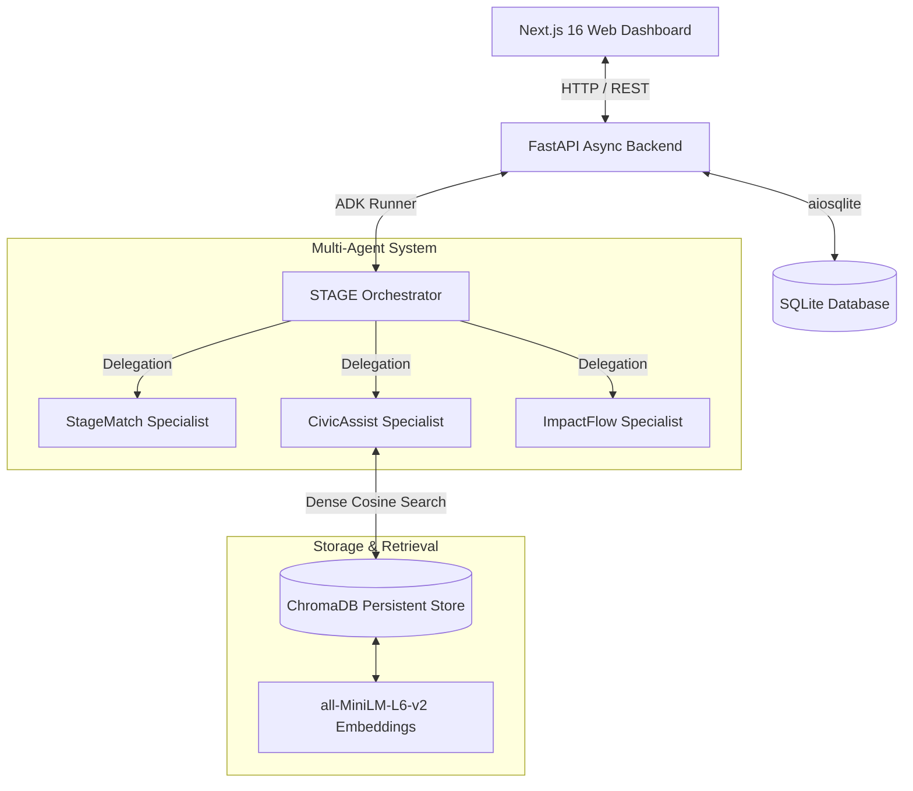

# Technical Architecture: STAGE Multi-Agent Platform

## System Overview

STAGE is an autonomous multi-agent platform designed to bridge performance artists, venue hosts, civic authorities, and community causes. The system combines modern web technologies, an asynchronous backend API, Google Agent Development Kit (ADK) orchestration, and local semantic retrieval.

## Agent Workflows and Execution Modes

The platform supports three distinct execution paths:

1. **Live ADK Mode**: Connects directly to Google Gemini using `google-adk` and `google-genai`. Agent actions and tool invocations stream observable events to the client.
2. **Offline Deterministic Fallback**: In the absence of an API key or during transient model unavailability, a rule-based engine routes queries deterministically without simulating fictitious AI thoughts.
3. **Partial Failure Mode**: If execution fails after an agent has performed state-altering actions, the workflow terminates safely without duplicating database mutations or restarting uncommitted operations.

## Multi-Agent Specialization

- **StageMatch Specialist**: Filters and ranks venues based on acoustics, capacity, location, and equipment requirements.
- **CivicAssist Specialist**: Analyzes civic guidelines, curfew restrictions, sound levels, and municipal compliance through semantic vector search.
- **ImpactFlow Specialist**: Identifies relevant charitable and social initiatives to link with live performances and calculates ticket pledge allocations.
